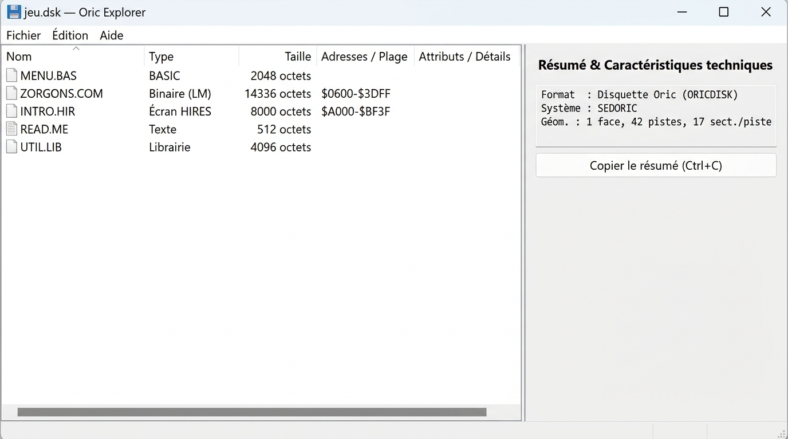
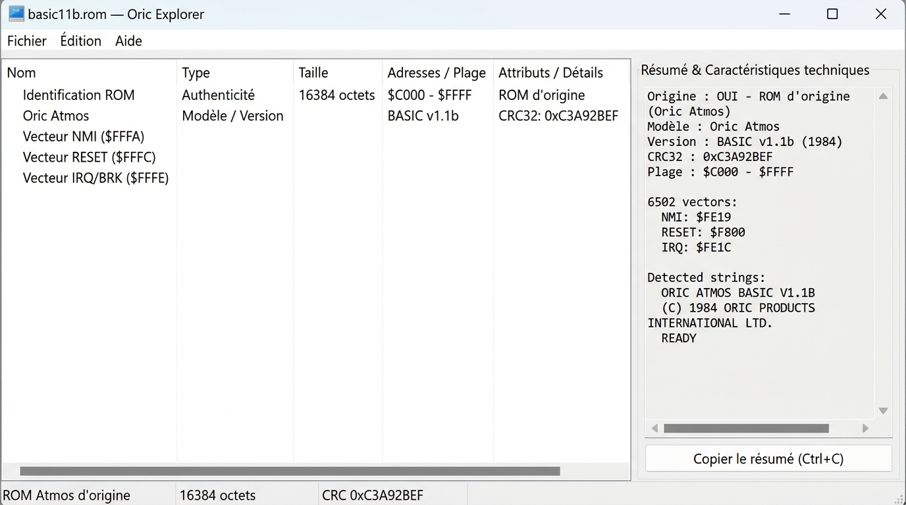
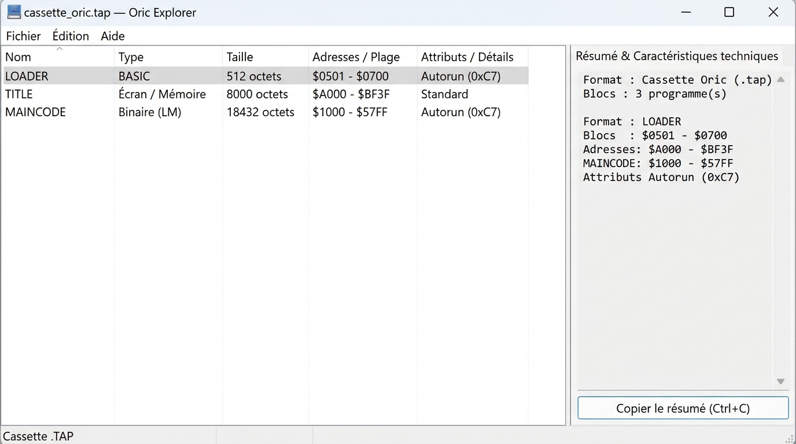

# Oric Explorer

A lightweight, native **Win32 C11 Unicode** desktop utility for Windows with **zero external dependencies**. **Oric Explorer** lets you inspect, decode, preview, extract, and convert **Oric-1**, **Oric Atmos**, **Telestrat**, **Pravetz 8D**, and Oric peripheral media (`.tap` cassettes, `.dsk` floppy disk images, and `.rom` / `.bin` ROMs) using only the native Windows API.

---

## Features

### Native Win32 GUI & Windows Integration
- **Zero external libraries**: Built purely with standard Windows APIs (`user32`, `gdi32`, `comctl32`, `comdlg32`, `shell32`) and Common Controls v6 with DPI awareness.
- **Portable `.ini` Settings (`OricExplorer.ini`)**: No Windows Registry writes—language, recent files, last explored folder, and emulator configurations are stored in `OricExplorer.ini` in the current directory.
- **Built-in File Explorer & `Esc` Navigation**: Browse drives and folders directly inside the app to open `.tap`, `.dsk`, `.rom`, and `.bin` files; press **`Esc`** (or click **`< Explorer`**) inside the Analyzer to return straight to the File Explorer.
- **Multilingual UI (EN / FR / DE / ES)**: Auto-detects the Windows UI language on startup and switches live between **English**, **French**, **German**, and **Spanish** via the **Language** menu.
- **Custom Retro Icon & Recent Files**: Embedded multi-resolution Oric Atmos `.ico` resource and a persistent **Recent Files** submenu.
- **Quick Filter & Column Sorting**: Filter files in the File Explorer or entries in the Analyzer live, and click any column header to toggle ascending/descending sort.
- **Drag & Drop + Command Line**: Drop any `.tap`, `.dsk`, `.rom`, `.bin`, or folder onto the window (or pass a path on the command line).
- **Configurable `.tap` / `.dsk` Emulators (`F5`)**: Set separate emulator executables and command-line templates (e.g. `"%s"` or `--disk "%s"`) for `.tap` cassettes and `.dsk` floppy disks via **Tools → Configure Emulators**.

### 3-Tab Inspector Sidebar & Native Previews
1. **Summary**: Media diagnostics, volume geometry/free sectors, ROM authenticity & vectors, selected item details, and **Copy Text (`Ctrl+C`)**.
2. **Code / Hex**:
   - **Oric BASIC Detokenizer**: Decodes tokenized Oric Extended BASIC (`0x80`–`0xF6`) programs from `.tap` or `.BAS` disk files into readable BASIC listings.
   - **6502 Disassembler**: Full official NMOS 6502 instruction disassembler for machine-code programs and ROM entry vectors (`NMI` / `RESET` / `IRQ`).
   - **Hex / ASCII Dump**: Toggle any time between code view and formatted 16-byte Hex/ASCII dump.
3. **Screen / Map (Native Win32 GDI + PNG Export)**:
   - **Oric HIRES (`240x200`) & TEXT (`40x28`) Viewer**: Renders ULA serial attributes (`$00–$07` ink, `$10–$17` paper, bit-7 hardware video inversion) directly via `StretchDIBits`.
   - **Visual Disk Sector Map**: Displays a color-coded Track x Sector map (Free, Used, System, and Selected File's allocated sectors).
   - **Save Image as PNG (`.png`)**: Export rendered HIRES/TEXT screens or disk sector maps directly as lossless PNG files using a built-in pure-C11 PNG encoder (zero external libraries).

### Supported Formats, Extraction & Conversions
- **Cassette Tapes (`.tap`)**: Single and multi-program `.tap` streams (`0x16` leader / `0x24` sync), memory boundaries, and autorun flags.
- **Floppy Disks (`.dsk`)**: Supports both **`ORICDISK`** and raw **`MFM_DISK`** containers across **SEDORIC**, **StratSED** (Telestrat), **FT-DOS** (Jasmin), and **OricDOS** (Microdisc).
- **Extraction, Image & Audio Conversion (Right-Click Context Menu / Tools Menu)**:
  - **Extract Raw Binary (`.bin`)**: Extract individual files from `.tap` blocks or floppy `.dsk` images.
  - **Export as `.tap`**: Wrap an extracted `.dsk` file into a standalone `.tap` cassette file.
  - **Export as `.wav` (48 kHz 8-bit PCM)**: Synthesize real Oric tape audio waveforms (start bit, 8 LSB bits, odd parity bit, stop bits) ready to load on real Oric hardware.
  - **Save Image as `.png`**: Save extracted HIRES/TEXT screens or sector maps to PNG.
- **ROM Identification (`.rom` / `.bin`)**:
  - Verifies **CRC32** against **Oric-1 v1.0** (`0xF18710B4`), **Oric Atmos v1.1b** (`0xC3A92BEF`), **Telestrat** (`telmon24.rom`, `hyperbas.rom`, `teleass.rom`), **Pravetz 8D** (`pravetzt.rom`), **Microdisc** (`0xA9664A9C`), **Byte Drive 500** (`0x61952E34`), and **Jasmin** (`0x37220E89`), plus charset hints (`Standard ASCII`, `French / AZERTY patch`, `Cyrillic`) and 6502 vectors (`NMI`, `RESET`, `IRQ`).

---

## Screenshots

### SEDORIC Floppy Disk Inspection (`.dsk`)


### Oric Atmos ROM Analysis (`.rom`)


### Oric Cassette Tape Inspection (`.tap`)


---

## Building from Source

### Prerequisites
- Windows with **MinGW-w64** (`gcc` and `windres` available in your `PATH`).

### Option 1 — Using `Makefile`
```sh
mingw32-make
```
To clean build artifacts:
```sh
mingw32-make clean
```

### Option 2 — Using `build.bat`
Double-click `build.bat` or run it from a Windows Command Prompt:
```bat
build.bat
```

Both methods generate `OricExplorer.exe` in the repository root.

---

## Repository Layout

- `Makefile` — Root build configuration for MinGW-w64 (`make` / `mingw32-make`).
- `build.bat` — Windows batch build script (Windows-1252 encoded, CRLF).
- `code/` — C11 Unicode source files (`main_win32.c`, `oric_*.c`), headers, Windows resource script (`app.rc`), custom icon (`oric.ico`), and Common Controls v6 / DPI manifest (`app.manifest`).
- `docs/screenshots/` — Application screenshots.
